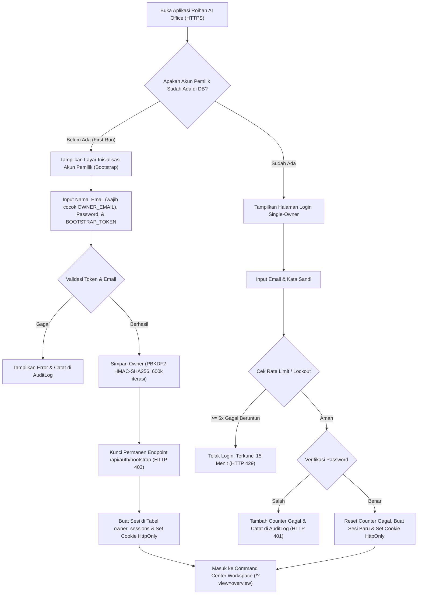
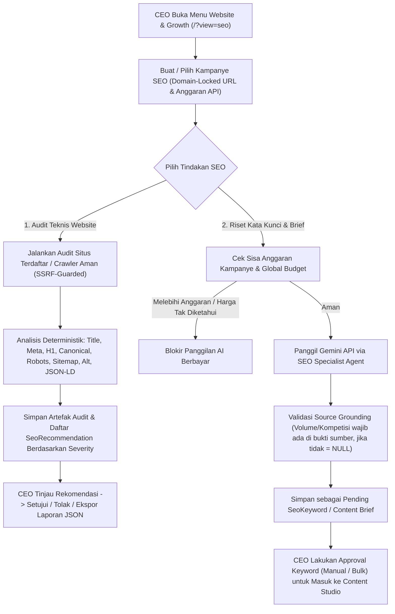
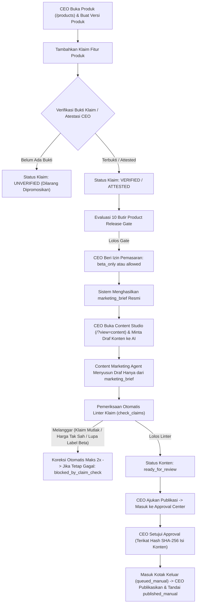
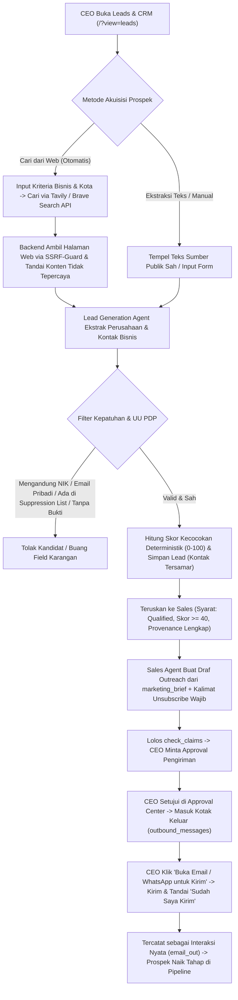

# 2. USER FLOW & OPERATIONAL WORKFLOWS

**Nama Produk:** Roihan AI Office  
**Aktor Utama:** Pemilik Bisnis / CEO (Single-Owner)  
**Aktor Sistem:** Marketing Orchestrator & 5 Agen Spesialis Marketing (SEO, Content, Lead Gen/CRM, Campaign/Social, Analytics)  

---

## 1. Alur Inisialisasi & Autentikasi Pemilik Tunggal (Single-Owner Auth Flow)

Sistem menggunakan arsitektur **Single-Owner** di mana hanya ada 1 akun pemilik yang sah di seluruh platform.

### Aturan Sesi & Logout:
- Setiap permintaan dari browser membawa cookie sesi `HttpOnly`, `SameSite=Lax`, `Secure`.
- Saat CEO menekan tombol **Logout** di dock navigasi, sesi di tabel `owner_sessions` langsung dicabut (*revoked*) dan cookie dihapus dari browser.

---

## 2. Navigasi Utama Command Center Workspace

Setelah login, CEO berada di dalam **Unified Command Center** (`/`) dan dapat berpindah tampilan kerja secara instan melalui dock navigasi vertikal:

| Menu Navigasi | Parameter URL / Rute | Tujuan Operasional Utama |
| :--- | :--- | :--- |
| **1. Overview** | `/?view=overview` | Memantau KPI utama, keputusan tertunda (Approval/Outbox), status agen, dan penggunaan kuota AI. |
| **2. Website & Growth** | `/?view=seo` | Mengelola kampanye SEO, menjalankan audit teknis website, meriset keyword, dan meninjau rekomendasi. |
| **3. Content Studio** | `/?view=content` | Mengelola katalog produk, membuat brief & draf konten AI, memvalidasi klaim, dan mengatur kalender konten. |
| **4. Social Media** | `/?view=social` | Menjadwalkan distribusi konten sosial media dan memantau status publikasi per kanal. |
| **5. Campaigns** | `/?view=campaigns` | Merencanakan kampanye pemasaran, mengelola anggaran, dan mencatat metrik hasil kampanye. |
| **6. Leads & CRM** | `/?view=leads` | Mencari prospek B2B dari web/sumber publik, menilai skor prospek, dan mengelola tahapan *sales pipeline*. |
| **7. Email & Automation** | `/?view=email` | Menyusun draf outreach yang dipersonalisasi dan mengelola pengiriman dari Kotak Keluar (*Outbox*). |
| **8. Analytics** | `/?view=analytics` | Menganalisis tren trafik organik, konversi pipeline, dan perhitungan ROI berbasis bukti data. |
| **9. Operations** | `/?view=operations` (`approvals` / `tasks`) | Menyetujui/menolak tindakan berisiko di Approval Center, memantau antrean Task Engine, dan kontrol daya OFF/ON. |
| **10. Settings** | `/?view=settings` (`ai`) | Mengatur kunci & model Google Gemini API, batas anggaran bulanan, akses web agen, dan backup database. |

---

## 3. Alur Pertumbuhan Website & Autonomous SEO (`/?view=seo`)

---

## 4. Alur Katalog Produk, Gerbang Rilis & Content Studio (`/?view=content`)

Marketing dilarang keras mempromosikan produk yang belum siap atau membuat klaim palsu.

---

## 5. Alur Akuisisi Prospek B2B, CRM & Outreach (`/?view=leads` & `/?view=email`)

### Penanganan Opt-Out (Berhenti Dihubungi):
- Jika prospek menolak (*opt-out*), CEO menekan tombol **Opt-Out**.
- Sistem menyimpan hash SHA-256 email/domain ke `suppression_entries`, membatalkan seluruh pesan keluar yang tertunda untuk prospek tersebut, dan memblokir pendaftaran ulang secara permanen.

---

## 6. Alur Persetujuan Manusia (Approval Center Lifecycle)

1. Setiap tugas dengan tingkat risiko `High` atau `Critical` (misalnya `publish`, `external_outreach`, `spend`) otomatis berhenti dengan status `pending_approval`.
2. Sistem membuat entri di tabel `approvals` yang mengikat **sidik jari SHA-256 (`payload_hash`)** dari rincian tindakan.
3. CEO membuka `/?view=approvals`, membaca isi persis yang akan dilakukan, lalu memilih **Setujui (`Approve`)** atau **Tolak (`Reject`)**:
   - **Jika Disetujui:** Task berpindah ke `queued`. Saat worker mengeksekusi task, worker memverifikasi ulang bahwa approval belum kedaluwarsa (TTL 24 jam), belum pernah dipakai, dan hash isi task tidak berubah.
   - **Jika Isi Task Diubah Setelah Disetujui:** Approval otomatis gugur dan task wajib meminta approval baru.
   - **Jika Ditolak atau Kedaluwarsa:** Task langsung dibatalkan (`cancelled`) tanpa pernah dieksekusi.

---

## 7. Alur Kontrol Daya Kantor (Office Power Control: OFF / ON & Recovery)

Digunakan saat CEO ingin menjeda seluruh aktivitas agen AI atau memulihkan pekerjaan setelah gangguan:

1. **Menekan Tombol OFF (`POST /api/power/off`):**
   - Status global berpindah dari `RUNNING` ke `PAUSING`.
   - Scheduler berhenti mengambil tugas baru.
   - Tugas yang sedang berjalan diberi waktu tenggang (`POWER_PAUSE_GRACE_S`) untuk menyelesaikan langkah aman, lalu diinterupsi secara terkontrol (`interrupted` dengan alasan `paused`).
   - Sistem menulis dan memverifikasi integritas `task_checkpoints` (SHA-256) di database.
   - Setelah terverifikasi, status global berubah menjadi `PAUSED`.
2. **Menekan Tombol ON (`POST /api/power/on`):**
   - Status global berubah menjadi `RESUMING`.
   - Sistem memvalidasi database, dependensi, dan checkpoint terakhir.
   - Tugas yang sudah `completed` tidak pernah dijalankan ulang.
   - Tugas aman/idempoten yang terputus dipulihkan kembali ke antrean (`queued`).
   - Tugas berisiko tinggi atau operasi eksternal yang statusnya belum pasti ditandai sebagai `RecoveryItem` (`RECOVERY_REQUIRED`) agar CEO memilih tindakan manual (*Antre Ulang*, *Batalkan*, atau *Konfirmasi Sudah/Belum Terjadi*).
