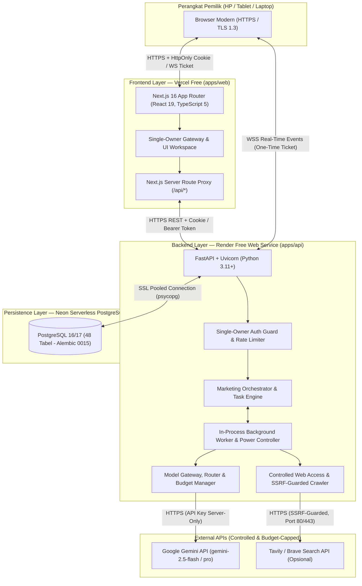

# 3. SYSTEM ARCHITECTURE

**Nama Produk:** Roihan AI Office  
**Pola Arsitektur:** Modular Monolith (Cloud-Ready & Local-Ready)  
**Dokumen Acuan:** Konsolidasi Master Addendum v1.0, v1.1, v2.0, dan v2.1  

---

## 1. Gambaran Umum Arsitektur (High-Level Architecture)

Roihan AI Office dibangun menggunakan pola **Modular Monolith** yang memisahkan tanggung jawab modul secara ketat di dalam satu repositori terpadu (`roihan-ai-office`), sehingga mudah dipelihara, diuji, dan di-deploy dengan biaya infrastruktur awal **Rp0** tanpa kompleksitas microservices.



---

## 2. Spesifikasi Stack Teknologi

| Lapisan | Teknologi / Library | Versi Target / Standar | Peran Utama |
| :--- | :--- | :--- | :--- |
| **Frontend Framework** | Next.js (App Router) + React | Next.js `16.4.x`, React `19.3.x` | Rendering UI, SSR proxy ke backend, state management, transisi halaman. |
| **Bahasa Frontend** | TypeScript | TypeScript `5.x` | Keamanan tipe statis di seluruh komponen dan klien API. |
| **Styling & Design System** | CSS Variables + Modern Minimalist SaaS Tokens | Font `@fontsource-variable/montserrat` | Desain bersih, responsif, kontras tinggi (WCAG 2.2 AA), bebas ketergantungan font jaringan luar. |
| **Backend Framework** | Python + FastAPI + Starlette + Uvicorn | Python `3.10+` (`3.11+` di Cloud), FastAPI `0.150.x` | REST API, WebSocket server, autentikasi, validasi skema, dan background lifespan worker. |
| **Validasi & ORM** | Pydantic + SQLAlchemy + Alembic | Pydantic `2.14.x`, SQLAlchemy `2.1.x`, Alembic `1.20.x` | Validasi payload ketat, pemetaan relasional ORM, dan manajemen migrasi skema (revisi `0015`). |
| **Database Utama** | PostgreSQL (`psycopg[binary]`) | PostgreSQL `16` / `17` (Neon Serverless / Lokal) | Penyimpanan persisten seluruh 48 tabel (operasional, sesi, task, checkpoint, SEO, CRM, audit log). |
| **AI Provider Utama** | Google Gemini API + FakeProvider | `gemini-2.5-flash` & `gemini-2.5-pro` | Inferensi AI untuk agen pemasaran; `FakeProvider` untuk pengujian regresi otomatis tanpa biaya. |
| **Testing Suite** | Pytest (Backend) & Vitest (Frontend) | Pytest + Vitest `5.x` | Unit test, integration test, security audit test, dan mutation verification. |

---

## 3. Arsitektur Lapisan & Komponen Inti

### 3.1 Frontend Layer (`apps/web`)
1. **Unified Command Center Shell (`src/app/page.tsx`):**
   - Menyajikan seluruh modul pemasaran dalam satu *workspace* terpadu (`/?view=overview`, `seo`, `content`, `social`, `campaigns`, `leads`, `email`, `analytics`, `operations`, `settings`) serta halaman detail (`/tasks/[id]`, `/marketing/campaigns/[id]`, `/marketing/leads/[id]`, `/products/[id]`, `/projects/[id]`).
   - Menggunakan token visual **Modern Minimalist SaaS** (latar `#131517`, surface `#1e2226` / `#ffffff`, aksen `#ff6b35`, radius `14px–18px`).
2. **Server-Side API Proxy (`src/app/api/[...path]/route.ts`):**
   - Meneruskan request dari browser ke `API_BASE_URL` backend dengan menyertakan cookie sesi `HttpOnly` dan/atau `APP_LOCAL_TOKEN` di sisi server, sehingga token rahasia tidak pernah bocor ke bundel JavaScript klien.
3. **Real-Time Event Synchronization:**
   - Meminta tiket WebSocket sekali pakai (berlaku 30 detik) dari endpoint proxy, membuka koneksi WebSocket ke `/api/ws`, dan melakukan *catch-up* state melalui `/api/events?since=seq` serta *exponential backoff* saat terjadi *reconnect* atau *cold-start*.

### 3.2 Backend Layer (`apps/api`)
1. **Single-Owner Authentication & Security Middleware (`app/auth/`, `app/security/`):**
   - Memvalidasi sesi pemilik dari tabel `owner_sessions` atau Bearer token (`secrets.compare_digest`).
   - Mengelola bootstrap akun pemilik sekali pakai (`/api/auth/bootstrap`), hashing `PBKDF2-HMAC-SHA256` (600.000 iterasi), pembatasan percobaan login (kunci 15 menit setelah 5x gagal), dan injeksi header keamanan ketat (`CSP`, `X-Frame-Options: DENY`, `X-Content-Type-Options: nosniff`, `Referrer-Policy: no-referrer`).
2. **Marketing Orchestrator & Task Engine (`app/tasks/`, `app/orchestrator/`):**
   - Mengelola antrean tugas berbasis database (*database-backed queue*) dengan validasi tabel transisi status yang ketat.
   - Mendukung resolusi dependensi antar-tugas (otomatis memblokir tugas hilir jika tugas hulu gagal/terblokir) dan batas percobaan ulang (`max_retries_per_task = 2`).
3. **AI Provider Adapter, Model Gateway & Router (`app/providers/`, `app/model_router/`, `app/budget/`):**
   - **Kontrak Seragam (`ModelProvider`):** Semua pemanggilan AI wajib melewati `ModelGateway` dan adapter `cloud.py` (Google Gemini API) atau `fakes.py` (`FakeProvider`). Tidak ada lagi dependensi runtime ke Ollama.
   - **Model Router:** Menghitung *Difficulty Score* (0–100 dari 6 faktor berbobot) dan *Risk Level* deterministik (`Low`, `Medium`, `High`, `Critical`). Memilih `gemini-2.5-flash` untuk tugas rutin dan `gemini-2.5-pro` untuk analisis kompleks.
   - **Budget & Quota Enforcement:** Memeriksa `BUDGET_ALLOW_PAID_CALLS`, `BUDGET_MONTHLY_LIMIT`, `AI_MAX_TOKENS_CAP`, serta sisa anggaran spesifik kampanye SEO sebelum memanggil API berbayar. Mencatat penggunaan token dan biaya ke tabel append-only `model_usage` tanpa menyimpan isi prompt mentah.
4. **Modul Operasional Marketing (`app/marketing/`):**
   - **Autonomous SEO Engine (`seo.py`, `seo_agents.py`, `sites.py`):** Mengelola kampanye SEO, audit HTML/situs deterministik, ekstraksi keyword berbasis bukti, dan rekomendasi prioritas.
   - **Product Catalog & Claim Linter (`products/`):** Menegakkan 10 syarat *Product Release Gate*, menghasilkan `marketing_brief` resmi, dan menjalankan pemeriksa klaim `check_claims` pada setiap draf konten/outreach.
   - **Lead Management, CRM & Privacy Guard (`leads/`, `access.py`):** Menilai skor prospek deterministik (0–100), menyamarkan PII secara bawaan, menolak data sensitif (NIK/kartu/email pribadi non-inbound), dan menegakkan *suppression list* berbasis hash.
   - **Content, Campaigns & Outbox (`content/`, `campaigns/`, `outbox/`):** Mengelola siklus hidup konten dan pesan keluar melalui *Approval Gate* yang terikat hash isi (`body_hash`).
5. **Controlled Web Access & SSRF Guard (`app/web/`):**
   - Menyediakan pencarian web terkendali melalui **Tavily** atau **Brave Search API** dan pengambilan halaman publik dengan perlindungan SSRF berlapis (menolak IP privat/loopback/metadata cloud pasca-resolusi DNS dan pada setiap redirect, membatasi port 80/443, mematuhi `robots.txt`, membatasi ukuran 500 KB & timeout 15 detik, serta menandai teks sebagai konten tidak tepercaya).
6. **Office Power Controller & Backup Manager (`app/power/`, `app/backup/`):**
   - Mengendalikan state operasional global (`RUNNING`, `PAUSING`, `PAUSED`, `RESUMING`, `RECOVERY_REQUIRED`, `ERROR`), menyimpan `task_checkpoints` bertanda SHA-256, mendeteksi *unclean shutdown* saat startup, dan menyediakan utilitas snapshot/restore database terkompresi (`database.jsonl.gz` + `manifest.json`).

---

## 4. Struktur Direktori Repositori Target

```text
roihan-ai-office/
├── apps/
│   ├── web/                          # Frontend Next.js 16 (App Router, React 19, TS)
│   │   ├── public/                   # Aset statis, ikon merek, font lokal
│   │   └── src/
│   │       ├── app/                  # Rute App Router (/, /login, /tasks/[id], /api/[...path], dll.)
│   │       ├── components/           # Komponen UI Modern Minimalist SaaS
│   │       ├── i18n/                 # Kamus bahasa Indonesia (default) & Inggris
│   │       └── lib/                  # Utilitas klien API, brand, chart, & state helper
│   └── api/                          # Backend FastAPI (Python)
│       ├── alembic/                  # Skrip migrasi database (Revisi 0001 - 0015)
│       ├── app/
│       │   ├── api/                  # Endpoint routers (health, auth, marketing, seo, ai, tasks, approvals, power, dll.)
│       │   ├── approvals/            # Logika Approval Gate & verifikasi hash payload
│       │   ├── auth/                 # Single-Owner Auth, PBKDF2-HMAC-SHA256, & session manager
│       │   ├── backup/               # CLI & engine backup/restore snapshot JSONL.gz
│       │   ├── budget/               # Pengendalian biaya AI & pencatatan model_usage
│       │   ├── db/                   # Koneksi SQLAlchemy & session management
│       │   ├── events/               # WebSocket manager & sequence event bus
│       │   ├── marketing/            # Modul SEO, Leads/CRM, Content, Campaigns, Products, Sites
│       │   ├── model_router/         # Difficulty scoring, risk override, & pemilihan model
│       │   ├── orchestrator/         # Marketing Manager / task planner
│       │   ├── power/                # Office Power Control (OFF/ON, Checkpoint, Recovery)
│       │   ├── projects/             # Manajemen proyek & workspace terisolasi
│       │   ├── providers/            # Adapter Google Gemini API (cloud.py) & FakeProvider (fakes.py)
│       │   ├── security/             # SSRF guard, secret redaction, PII filter, security headers
│       │   ├── tasks/                # Task Engine, background worker, & executors
│       │   ├── web/                  # Integrasi pencarian Tavily/Brave & web fetcher aman
│       │   ├── config.py             # Validasi konfigurasi environment (Pydantic Settings)
│       │   └── main.py               # Entrypoint aplikasi FastAPI & lifespan management
│       └── tests/                    # Suite pengujian pytest (947 test cases) & FakeProvider
├── data/
│   ├── backups/                      # Snapshot cadangan database & manifest SHA-256
│   ├── projects/                     # Penyimpanan file proyek & salinan situs
│   └── logs/                         # Log aplikasi terstruktur (JSON, secret-redacted)
├── docs/                             # Dokumentasi resmi proyek (01_PRD s/d 10_OPERATIONS)
│   └── archive/                      # Arsip dokumen historis & laporan audit fase terdahulu
├── scripts/                          # Skrip audit keamanan, evaluasi DB, & game-day test
├── .env.example                      # Template variabel lingkungan lokal
├── .env.production.example           # Template variabel lingkungan cloud (Vercel/Render/Neon)
├── render.yaml                       # Blueprint deployment backend Render
└── vercel.json                       # Blueprint konfigurasi frontend Vercel
```

---

## 5. Ketahanan Terhadap Batasan Cloud Free-Tier (Zero-Cost Architecture)

Arsitektur dirancang secara spesifik untuk mengatasi batasan paket gratis (**Vercel Free + Render Free + Neon Free**):
1. **Stateless Container & Ephemeral Disk Safe:** Render Free mereset filesystem lokal setiap kali deploy atau restart. Oleh karena itu, seluruh data operasional, sesi login, antrean tugas, dan checkpoint disimpan 100% di **Neon Serverless PostgreSQL**.
2. **Cold-Start Resilience:** Render Free menghentikan sementara container setelah 15 menit tanpa trafik. Saat pengguna membuka aplikasi kembali, frontend menampilkan indikator sinkronisasi yang halus sementara koneksi dipulihkan, dan `PowerController.startup_recovery()` di backend otomatis melanjutkan state tugas yang tertunda.
3. **WebSocket Catch-Up:** Jika koneksi WebSocket terputus akibat *spin-down*, klien otomatis menyambung ulang dengan *exponential backoff* dan mengambil event yang terlewat melalui `GET /api/events?since=<last_seq>`.
