# 4. DATABASE SCHEMA & DATA MODEL

**Nama Produk:** Roihan AI Office  
**DBMS Utama:** PostgreSQL 16/17 (Neon Serverless di Cloud / PostgreSQL Lokal) — Kompatibel dengan SQLite untuk pengujian terisolasi  
**ORM & Migrasi:** SQLAlchemy 2.1 + Alembic 1.20 (Head Revision: `0015`, Total **48 Tabel**)  

---

## 1. Konvensi & Standar Data

1. **Primary Key:** Menggunakan UUID/ULID berbasis string (bukan integer sekuensial yang mudah ditebak), kecuali kolom urutan monoton seperti `seq` pada `task_events`.
2. **Zona Waktu (Timestamps):** Seluruh waktu (`created_at`, `updated_at`, `expires_at`, `occurred_at`) disimpan dalam standar **UTC**. Konversi ke waktu lokal pengguna dilakukan di lapisan UI.
3. **Append-Only Audit & Event Logs:** Tabel jejak audit dan riwayat kejadian (`audit_logs`, `task_events`, `model_usage`, `seo_campaign_events`, `product_release_checks`, `code_reviews`, `executions`, `recovery_log`) bersifat **append-only** (dilarang diubah atau dihapus).
4. **Soft Delete & Retensi:** Entitas bisnis utama mendukung penghapusan lunak (`deleted_at`) dan tunduk pada kebijakan retensi/anonimisasi sesuai **UU Pelindungan Data Pribadi (UU No. 27 Tahun 2022)**.
5. **Integritas & Kriptografi:**
   - Kata sandi pemilik disimpan menggunakan hash `PBKDF2-HMAC-SHA256` (salt 16-byte, 600.000 iterasi).
   - Daftar jangan-hubungi (`suppression_entries`) hanya menyimpan hash SHA-256 dari email/domain agar sistem tidak menyimpan data pribadi orang yang menolak dihubungi.
   - Checkpoint tugas (`task_checkpoints`) dan persetujuan (`approvals`) menyimpan hash SHA-256 (`payload_sha256` / `payload_hash`) untuk menjamin keutuhan data.

---

## 2. Diagram Relasi Entitas Utama (ERD)

```mermaid
erDiagram
    OWNER_ACCOUNTS ||--o{ OWNER_SESSIONS : "memiliki sesi aktif"
    PROJECTS ||--o{ PROJECT_FILES : "memuat berkas"
    PROJECTS ||--o{ TASKS : "memiliki tugas"
    PROJECTS ||--o| SITES : "terhubung ke situs"
    
    TASKS ||--o{ TASK_DEPENDENCIES : "bergantung pada"
    TASKS ||--o{ TASK_ATTEMPTS : "dieksekusi dalam"
    TASKS ||--o{ TASK_EVENTS : "mencatat riwayat"
    TASKS ||--o{ TASK_CHECKPOINTS : "menyimpan state"
    TASKS ||--o{ APPROVALS : "membutuhkan"
    TASKS ||--o{ ROUTING_DECISIONS : "diputuskan oleh router"
    TASKS ||--o{ MODEL_USAGE : "mencatat pemakaian AI"

    PRODUCTS ||--o{ PRODUCT_VERSIONS : "memiliki versi"
    PRODUCT_VERSIONS ||--o{ PRODUCT_FEATURES : "memiliki klaim fitur"
    PRODUCT_VERSIONS ||--o{ PRODUCT_RELEASE_CHECKS : "dievaluasi oleh gate"
    PRODUCTS ||--o{ CAMPAIGNS : "dipromosikan dalam"
    PRODUCTS ||--o{ CONTENT_ASSETS : "menjadi bahan konten"

    COMPANIES ||--o{ LEADS : "menaungi kontak prospek"
    LEAD_SOURCES ||--o{ LEADS : "menjadi bukti provenance"
    LEADS ||--o{ LEAD_INTERACTIONS : "memiliki riwayat interaksi"
    LEADS ||--o{ SALES_OPPORTUNITIES : "dikonversi menjadi"
    LEADS ||--o{ OUTREACH_Records : "menerima draf outreach"
    SALES_OPPORTUNITIES ||--o{ CLIENT_REQUIREMENTS : "memiliki rincian kebutuhan"

    SEO_CAMPAIGNS ||--o{ SEO_KEYWORDS : "melacak kata kunci"
    SEO_CAMPAIGNS ||--o{ SEO_RECOMMENDATIONS : "menghasilkan rekomendasi"
    SEO_CAMPAIGNS ||--o{ SEO_CAMPAIGN_EVENTS : "mencatat audit trail"
```

---

## 3. Katalog Tabel Berdasarkan Domain (48 Tabel Skema Alembic `0001`–`0015`)

### 3.1 Domain Autentikasi Single-Owner & Keamanan (Revisi `0015`)
| Nama Tabel | Deskripsi & Kolom Utama |
| :--- | :--- |
| `owner_accounts` | Menyimpan tepat **1 akun pemilik sah** (`id`, `full_name`, `email` unik, `password_hash` PBKDF2-HMAC-SHA256, `failed_login_attempts`, `locked_until`, `created_at`, `updated_at`). |
| `owner_sessions` | Menyimpan sesi login persisten pemilik (`id`, `owner_id`, `session_token_hash`, `ip_address`, `user_agent`, `expires_at`, `revoked_at`, `created_at`). |
| `audit_logs` | Jejak audit **append-only** untuk seluruh tindakan keamanan, login, approval, akses PII, dan perubahan konfigurasi (`id`, `actor`, `action`, `entity_type`, `entity_id`, `details_json` telah disamarkan dari rahasia/PII, `correlation_id`, `created_at`). |

### 3.2 Domain Core Platform, Proyek & Task Engine (Revisi `0001`–`0006`)
| Nama Tabel | Deskripsi & Kolom Utama |
| :--- | :--- |
| `projects` | Entitas wadah kerja/kampanye (`id`, `name`, `description`, `status`, `created_at`, `updated_at`, `deleted_at`). |
| `project_files` | Metadata berkas yang diunggah ke proyek (`id`, `project_id`, `category` [`master`, `requirement`, `reference`, `asset`], `filename`, `rel_path`, `size_bytes`, `sha256`, `mime_type`, `created_at`). |
| `tasks` | Unit pekerjaan terukur yang dijalankan agen (`id`, `project_id`, `title`, `description`, `role`, `action`, `status` [`draft`, `pending_approval`, `queued`, `running`, `blocked`, `completed`, `failed`, `cancelled`, `interrupted`], `priority`, `risk_level`, `acceptance_criteria_json`, `params_json`, `retry_count`, `max_retries`, `blocked_reason`, `review_status`, `created_at`, `updated_at`). |
| `task_dependencies` | Relasi ketergantungan antar-tugas (`task_id`, `depends_on_task_id`); bebas siklus (DAG). |
| `task_attempts` | Riwayat setiap percobaan eksekusi tugas (`id`, `task_id`, `attempt_number`, `status`, `worker_id`, `model_used`, `started_at`, `finished_at`, `error_code`, `error_message`, `output_summary`). |
| `task_events` | Urutan kejadian real-time **append-only** (`seq` identity monoton, `event_id`, `task_id`, `project_id`, `event_type`, `entity_type`, `entity_id`, `payload_json`, `occurred_at`). Dipakai untuk WebSocket & catch-up REST. |
| `approvals` | Siklus persetujuan manusia untuk tindakan berisiko tinggi/kritis (`id`, `task_id`, `action_type`, `risk_level`, `payload_preview_json`, `payload_hash` SHA-256, `status` [`pending`, `approved`, `rejected`, `expired`, `cancelled`], `decided_by`, `decision_reason`, `expires_at`, `consumed_at`, `created_at`). |
| `artifacts` | Artefak keluaran tugas umum seperti dokumen analisis dan laporan (`id`, `project_id`, `task_id`, `attempt_id`, `artifact_type`, `title`, `rel_path`, `content_text`, `sha256`, `created_at`). |

### 3.3 Domain AI Control Center, Model Router & Budget (Revisi `0003`–`0004`, `0013`)
| Nama Tabel | Deskripsi & Kolom Utama |
| :--- | :--- |
| `provider_configs` | Konfigurasi status penyedia AI (`provider_name` [`gemini`, `openai`, `anthropic`, `ollama`, `fake`], `enabled`, `default_model`, `config_json`, `updated_at`). |
| `model_capabilities` | Registri kemampuan model (`id`, `provider`, `model_id`, `available`, `context_limit`, `max_output`, `supports_tools`, `supports_structured`, `supports_vision`, `supports_streaming`, `input_cost_per_1m`, `output_cost_per_1m`, `benchmark_json`). |
| `routing_decisions` | Catatan keputusan pemilihan model oleh *Model Router* (`id`, `task_id`, `attempt_id`, `difficulty_score`, `difficulty_category`, `risk_level`, `selected_provider`, `selected_model`, `reason`, `created_at`). |
| `model_usage` | Ledger pemakaian token dan biaya AI **append-only** (`id`, `task_id`, `attempt_id`, `campaign_id`, `purpose`, `provider`, `model_id`, `prompt_hash`, `prompt_chars`, `input_tokens`, `output_tokens`, `estimated_cost_idr`, `actual_cost_idr`, `duration_ms`, `status`, `created_at`). |
| `budget_policies` | Kebijakan anggaran bulanan dan kontrol panggilan berbayar (`id`, `currency`, `monthly_limit`, `allow_paid_calls`, `require_approval_for_paid_calls`, `max_tokens_cap`, `updated_at`). |
| `web_requests` | Log audit pencarian dan pengambilan halaman web oleh agen (`id`, `task_id`, `role`, `provider` [`tavily`, `brave`, `direct_fetch`], `query_or_url`, `status_code`, `bytes_fetched`, `blocked_reason`, `created_at`). |

### 3.4 Domain Katalog Produk & Gerbang Rilis (Revisi `0007`)
| Nama Tabel | Deskripsi & Kolom Utama |
| :--- | :--- |
| `products` | Katalog produk digital atau jasa milik perusahaan (`id`, `name`, `slug`, `business_line` [`owned_product`, `service`], `description`, `target_audience`, `marketing_permission` [`not_allowed`, `beta_only`, `allowed`], `created_at`, `updated_at`). |
| `product_versions` | Versi dan status pengembangan produk (`id`, `product_id`, `version_number`, `status` [`draft`, `in_development`, `internal_testing`, `beta`, `released`, `deprecated`, `archived`], `pinned_commit`, `known_limitations`, `pricing_text`, `pricing_approved_hash`, `promotional_materials_reviewed`, `created_at`). |
| `product_features` | Klaim fitur produk beserta status buktinya (`id`, `version_id`, `claim_text`, `verification_status` [`unverified`, `verified`, `attested`, `disputed`, `withdrawn`], `evidence_task_id`, `attestation_reason`, `updated_at`). |
| `product_release_checks` | Riwayat evaluasi 10 syarat *Product Release Gate* **append-only** (`id`, `product_id`, `version_id`, `requested_permission`, `passed`, `checks_json`, `evaluated_by`, `created_at`). |

### 3.5 Domain Marketing, Leads, CRM & Kepatuhan UU PDP (Revisi `0008`–`0009`)
| Nama Tabel | Deskripsi & Kolom Utama |
| :--- | :--- |
| `companies` | Profil perusahaan prospek B2B yang telah dideduplikasi (`id`, `name`, `normalized_name`, `domain`, `industry`, `size_category`, `city`, `website_url`, `created_at`). |
| `lead_sources` | Bukti asal-usul (*provenance*) prospek (`id`, `source_type` [`public_website`, `public_registry`, `referral`, `inbound`, `event`, `manual`], `source_url`, `collection_method`, `collected_by`, `raw_excerpt`, `collected_at`). |
| `leads` | Data kontak bisnis prospek (`id`, `company_id`, `source_id`, `contact_name`, `contact_role`, `business_email`, `email_hash`, `business_phone`, `stage` [`new`, `qualified`, `contacted`, `meeting`, `opportunity`, `won`, `lost`, `disqualified`, `do_not_contact`], `fit_score`, `score_breakdown_json`, `legal_basis` [`legitimate_interest_b2b`, `inbound_inquiry`], `owner_role`, `last_interaction_at`, `anonymized_at`, `created_at`). |
| `lead_interactions` | Bukti interaksi nyata dengan prospek (`id`, `lead_id`, `interaction_type` [`note`, `email_out`, `email_in`, `call`, `meeting`], `summary`, `recorded_by`, `occurred_at`). |
| `suppression_entries` | Daftar jangan-hubungi (*opt-out*) permanen berbasis hash (`id`, `email_hash`, `domain_hash`, `reason` [`opt_out`, `erasure_request`, `bounce`], `created_at`). Tidak menyimpan teks email asli. |
| `sales_opportunities` | Peluang penjualan di *Sales Pipeline* (`id`, `lead_id`, `product_id`, `title`, `stage` [`qualification`, `proposal`, `negotiation`, `won`, `lost`], `estimated_value_idr`, `actual_value_idr`, `win_loss_reason`, `closed_at`, `created_at`). |
| `client_requirements` | Catatan kebutuhan calon klien pada peluang penjualan (`id`, `opportunity_id`, `requirement_text`, `priority`, `created_at`). |
| `client_handoffs` | Riwayat serah-terima peluang menang menjadi proyek internal (`id`, `opportunity_id`, `project_id`, `handed_off_at`). |
| `market_research` | Temuan riset pasar beserta status verifikasi kutipannya (`id`, `project_id`, `product_id`, `topic`, `finding_text`, `source_quote`, `verification_status` [`verified`, `assumption`], `created_at`). |
| `outreach_records` | Draf pesan pendekatan B2B (`id`, `lead_id`, `product_id`, `channel`, `subject`, `body_text`, `body_hash`, `claim_check_status`, `claim_check_issues_json`, `status` [`draft`, `ready_for_review`, `blocked_by_claim_check`, `pending_approval`, `queued_manual`, `sent_manual`, `cancelled`], `created_at`). |
| `content_assets` | Aset materi konten pemasaran (`id`, `product_id`, `campaign_id`, `content_type` [`social_post`, `article`, `landing_page`, `demo_script`, `newsletter`], `channel`, `title`, `body_text`, `body_hash`, `claim_check_status`, `status`, `scheduled_for`, `published_at`, `created_at`). |
| `campaigns` | Kampanye pemasaran lintas kanal (`id`, `product_id`, `name`, `objective`, `channels_json`, `status` [`draft`, `active`, `paused`, `completed`], `budget_idr`, `start_date`, `end_date`, `created_at`). |
| `campaign_metrics` | Pencatatan metrik hasil kampanye (`id`, `campaign_id`, `period`, `impressions`, `clicks`, `conversions`, `cost_idr`, `revenue_idr`, `recorded_by`, `created_at`). |
| `outbound_messages` | Kotak keluar (*Outbox*) untuk pesan outreach dan publikasi konten yang sudah disetujui CEO (`id`, `item_type` [`outreach`, `content_publish`], `item_id`, `channel`, `recipient_or_target`, `body_hash`, `approval_id`, `status` [`queued_manual`, `dispatched_manual`, `cancelled`], `dispatched_at`, `created_at`). |

### 3.6 Domain Website Growth & Autonomous SEO (Revisi `0011`, `0012`, `0014`)
| Nama Tabel | Deskripsi & Kolom Utama |
| :--- | :--- |
| `sites` | Situs web yang terdaftar untuk dipasarkan dan diaudit (`id`, `project_id`, `name`, `base_url`, `workspace_rel_path`, `last_audited_at`, `created_at`). |
| `marketing_artifacts` | Artefak hasil kerja SEO Specialist & Marketing Analytics seperti hasil audit HTML, riset keyword, content brief, dan laporan analitik (`id`, `site_id`, `project_id`, `task_id`, `artifact_kind`, `title`, `data_json`, `created_at`). |
| `seo_metrics` | Pencatatan KPI pencarian organik per periode (`id`, `site_id`, `period_yyyy_mm`, `impressions`, `clicks`, `organic_sessions`, `conversions`, `avg_position`, `created_at`). |
| `seo_campaigns` | Kampanye Autonomous SEO terkunci domain (`id`, `site_id`, `name`, `target_domain`, `objective`, `autonomy_level` [`READ_ONLY`, `STAGING_WRITE`, `APPROVED_PRODUCTION_WRITE`], `status` [`draft`, `active`, `paused`, `completed`, `archived`], `api_budget_limit_idr`, `api_budget_spent_idr`, `external_integrations_json`, `created_at`, `updated_at`). |
| `seo_keywords` | Kata kunci kampanye SEO beserta bukti sumber (`id`, `campaign_id`, `keyword_text`, `search_intent`, `search_volume` [nullable jika tak ada bukti], `competition` [nullable], `source_type`, `evidence_quote`, `approval_status` [`pending`, `approved`, `rejected`], `approved_by`, `created_at`). |
| `seo_recommendations` | Rekomendasi perbaikan teknis/on-page dari hasil audit (`id`, `campaign_id`, `audit_artifact_id`, `page_url`, `issue_code`, `severity` [`critical`, `warning`, `info`], `title`, `recommendation_text`, `evidence_json`, `impact`, `effort`, `risk`, `approval_status` [`pending`, `approved`, `rejected`, `implemented`], `created_at`). |
| `seo_campaign_events` | Log kejadian kampanye SEO **append-only** (`id`, `campaign_id`, `event_type`, `actor`, `details_json`, `created_at`). |

### 3.7 Domain Office Power Control, Checkpoint & Infrastruktur Bersama (Revisi `0005`–`0006`, `0010`)
| Nama Tabel | Deskripsi & Kolom Utama |
| :--- | :--- |
| `power_state` | Tabel *singleton* (1 baris) penyimpan status operasional global kantor (`id=1`, `state` [`RUNNING`, `PAUSING`, `PAUSED`, `RESUMING`, `RECOVERY_REQUIRED`, `ERROR`], `scheduling_enabled`, `shutdown_clean`, `active_command_id`, `last_transition_at`, `updated_at`). |
| `power_commands` | Riwayat perintah OFF dan ON beserta progres langkahnya (`id`, `command_type` [`OFF`, `ON`], `status`, `steps_json`, `requested_by`, `started_at`, `completed_at`). |
| `task_checkpoints` | Salinan state kerja tugas yang dapat diverifikasi (`id`, `project_id`, `task_id`, `attempt_id`, `role`, `step_name`, `context_summary`, `file_hashes_json`, `git_state_json`, `tool_results_json`, `model_usage_summary_json`, `schema_version`, `payload_sha256`, `is_valid`, `created_at`). |
| `recovery_items` | Daftar item masalah yang membutuhkan keputusan manual CEO (`id`, `task_id`, `item_type` [`risky_task_interrupted`, `uncertain_external_op`, `missing_project_files`, `stop_unconfirmed`, `invalid_checkpoint`, `retries_exhausted`], `status` [`open`, `resolved`], `resolution_action`, `resolved_by`, `created_at`, `resolved_at`). |
| `recovery_log` | Catatan audit proses pemulihan pasca-pause/crash **append-only** (`id`, `command_id`, `task_id`, `action_taken`, `details_json`, `created_at`). |
| `external_operations` | Pelacak idempotensi operasi eksternal (`id`, `idempotency_key` unik, `task_id`, `operation_type`, `status` [`started`, `succeeded`, `failed`, `unknown`], `target_ref`, `created_at`, `updated_at`). |
| `executions` / `test_runs` / `test_results` / `code_reviews` | Tabel infrastruktur eksekusi bersama yang dipertahankan di skema untuk stabilitas migrasi dan pengujian internal. |

---

## 4. Kebijakan Retensi Data & Privasi (UU PDP Compliance)

| Jenis Data | Kebijakan Penyimpanan & Retensi | Mekanisme Penegakan |
| :--- | :--- | :--- |
| **Data Prospek B2B (`leads`)** | Dianonimkan setelah **180 hari** tanpa interaksi atau **730 hari** setelah interaksi terakhir (kecuali memiliki peluang penjualan terbuka). | Endpoint `/api/marketing/retention` menandai data jatuh tempo; dieksekusi oleh CEO. |
| **Permintaan Opt-Out (`suppression_entries`)** | Disimpan **permanen** hanya dalam bentuk hash SHA-256 (`email_hash` & `domain_hash`). | Dicek otomatis sebelum pembuatan prospek, draf outreach, dan pengiriman kotak keluar. |
| **Kontak Bisnis Prospek (PII)** | Disamarkan (*masked*, mis. `b***@perusahaan.co.id`) secara default pada response API & UI. | Pembukaan kontak asli wajib memanggil endpoint reveal yang mencatat `lead.pii_viewed` di `audit_logs`. |
| **Log Pemakaian AI (`model_usage`)** | Hanya menyimpan `prompt_hash` dan jumlah karakter/token; **tidak pernah** menyimpan isi teks prompt atau rahasia. | Ditegakkan langsung di `ModelGateway`. |
| **Checkpoint Tugas (`task_checkpoints`)** | Menyimpan `POWER_CHECKPOINT_KEEP` checkpoint valid terbaru per tugas; seluruh teks disaring dengan `redact_secrets_in_logs`. | Dipangkas otomatis secara transaksional saat penulisan checkpoint baru. |
