# 4. DATABASE SCHEMA & DATA MODEL

**Nama Produk:** Roihan AI Office  
**DBMS Utama:** PostgreSQL 16/17 (Neon Serverless di Cloud / PostgreSQL Lokal) — Kompatibel dengan SQLite untuk pengujian terisolasi  
**ORM & Migrasi:** SQLAlchemy 2.1 + Alembic 1.20 (Head Revision: `0015`, Total **49 Tabel**)  

---

## 1. Konvensi & Standar Data

1. **Primary Key:** Menggunakan UUID/ULID berbasis string (bukan integer sekuensial yang mudah ditebak), kecuali kolom urutan monoton seperti `seq` pada `task_events`.
2. **Zona Waktu (Timestamps):** Seluruh waktu (`created_at`, `updated_at`, `expires_at`, `occurred_at`) disimpan dalam standar **UTC**. Konversi ke waktu lokal pengguna dilakukan di lapisan UI.
3. **Append-Only Audit & Event Logs:** Tabel jejak audit dan riwayat kejadian (`audit_logs`, `task_events`, `model_usage`, `seo_campaign_events`, `product_release_checks`, `code_reviews`, `executions`, `recovery_log`) bersifat **append-only** (dilarang diubah atau dihapus; ditegakkan via listener SQLAlchemy `_enforce_append_only`).
4. **Soft Delete & Retensi:** Entitas bisnis utama mendukung penghapusan lunak (`deleted_at`) dan tunduk pada kebijakan retensi/anonimisasi sesuai **UU Pelindungan Data Pribadi (UU No. 27 Tahun 2022)**.
5. **Integritas & Kriptografi:**
   - Kata sandi pemilik disimpan menggunakan hash `PBKDF2-HMAC-SHA256` (salt 16-byte, 600.000 iterasi) di tabel `owner_users`.
   - Token sesi pemilik disimpan dalam bentuk digest SHA-256 (`session_token` 64-karakter hex) di tabel `owner_sessions`. Token mentah hanya diteruskan via cookie `HttpOnly` ke browser dan tidak disimpan plain text di database.
   - Daftar jangan-hubungi (`suppression_entries`) hanya menyimpan hash SHA-256 dari email/domain (`value_hash`) agar sistem tidak menyimpan data pribadi orang yang menolak dihubungi.
   - Checkpoint tugas (`task_checkpoints`) dan persetujuan (`approvals`) menyimpan hash SHA-256 (`payload_sha256` / `payload_hash`) untuk menjamin keutuhan data.

---

## 2. Diagram Relasi Entitas Utama (ERD)

```mermaid
erDiagram
    OWNER_USERS ||--o{ OWNER_SESSIONS : "memiliki sesi aktif"
    PROJECTS ||--o{ PROJECT_FILES : "memuat berkas"
    PROJECTS ||--o{ TASKS : "memiliki tugas"
    PROJECTS ||--o| SITES : "terhubung ke situs"
    
    TASKS ||--o{ TASK_DEPENDENCIES : "bergantung pada"
    TASKS ||--o{ TASK_ATTEMPTS : "dieksekusi dalam"
    TASKS ||--o{ TASK_EVENTS : "mencatat riwayat"
    TASKS ||--o{ TASK_CHECKPOINTS : "menyimpan state"
    TASKS ||--o{ APPROVALS : "membutuhkan"
    TASKS ||--o{ ROUTING_DECISIONS : "diputuskan oleh router"
    TASKS ||--o{ MODEL_USAGE : "mencatat pemakaian AI"

    PRODUCTS ||--o{ PRODUCT_VERSIONS : "memiliki versi"
    PRODUCT_VERSIONS ||--o{ PRODUCT_FEATURES : "memiliki klaim fitur"
    PRODUCT_VERSIONS ||--o{ PRODUCT_RELEASE_CHECKS : "dievaluasi oleh gate"
    PRODUCTS ||--o{ CAMPAIGNS : "dipromosikan dalam"
    PRODUCTS ||--o{ CONTENT_ASSETS : "menjadi bahan konten"

    COMPANIES ||--o{ LEADS : "menaungi kontak prospek"
    LEAD_SOURCES ||--o{ LEADS : "menjadi bukti provenance"
    LEADS ||--o{ LEAD_INTERACTIONS : "memiliki riwayat interaksi"
    LEADS ||--o{ SALES_OPPORTUNITIES : "dikonversi menjadi"
    LEADS ||--o{ OUTREACH_RECORDS : "menerima draf outreach"
    SALES_OPPORTUNITIES ||--o{ CLIENT_REQUIREMENTS : "memiliki rincian kebutuhan"

    SEO_CAMPAIGNS ||--o{ SEO_KEYWORDS : "melacak kata kunci"
    SEO_CAMPAIGNS ||--o{ SEO_RECOMMENDATIONS : "menghasilkan rekomendasi"
    SEO_CAMPAIGNS ||--o{ SEO_CAMPAIGN_EVENTS : "mencatat audit trail"
    SITES ||--o{ MARKETING_ARTIFACTS : "menghasilkan artefak audit"
```

---

## 3. Katalog Lengkap 49 Tabel Skema Database (Alembic `0001`–`0015`)

Sistem memiliki tepat **49 tabel** terdaftar di `Base.metadata.tables`:

### 3.1 Domain Autentikasi Single-Owner & Keamanan (3 Tabel)
| Nama Tabel | Deskripsi & Kolom Utama |
| :--- | :--- |
| `owner_users` | Menyimpan tepat **1 akun pemilik sah** (`id`, `email` unik, `password_hash` PBKDF2-HMAC-SHA256, `full_name`, `is_active`, `failed_login_attempts`, `locked_until`, `created_at`, `updated_at`). |
| `owner_sessions` | Menyimpan sesi login persisten pemilik (`id`, `user_id`, `session_token` hash SHA-256 64-karakter hex, `ip_address`, `user_agent`, `expires_at`, `revoked_at`, `created_at`). |
| `audit_logs` | Jejak audit **append-only** untuk seluruh tindakan keamanan, login, approval, akses PII, dan perubahan konfigurasi (`id`, `actor`, `action`, `entity_type`, `entity_id`, `details` JSON telah disamarkan dari rahasia/PII, `created_at`). |

### 3.2 Domain Core Platform, Proyek & Task Engine (6 Tabel)
| Nama Tabel | Deskripsi & Kolom Utama |
| :--- | :--- |
| `projects` | Entitas wadah kerja/kampanye (`id`, `name`, `description`, `status`, `created_at`, `updated_at`, `deleted_at`). |
| `project_files` | Metadata berkas proyek yang diunggah (`id`, `project_id`, `kind`, `filename`, `path`, `size_bytes`, `sha256`, `mime`, `created_at`). |
| `tasks` | Unit pekerjaan terukur yang dijalankan agen (`id`, `project_id`, `parent_task_id`, `title`, `description`, `role`, `action_type`, `status` [`draft`, `pending_approval`, `queued`, `running`, `blocked`, `completed`, `failed`, `cancelled`, `interrupted`], `priority`, `acceptance_criteria`, `risk_level`, `requires_approval`, `approved`, `difficulty_factors`, `difficulty_score`, `difficulty_category`, `preferred_model`, `requires_tools`, `attempt_count`, `attempts_baseline`, `max_retries`, `available_at`, `blocked_reason`, `last_error`, `last_error_kind`, `result`, `verification`, `review_status`, `params`, `created_by`, `started_at`, `finished_at`, `updated_at`, `created_at`). |
| `task_dependencies` | Relasi ketergantungan antar-tugas DAG (`task_id`, `depends_on_id`). |
| `task_attempts` | Riwayat percobaan eksekusi tugas (`id`, `task_id`, `number`, `status`, `error_kind`, `error_message`, `retryable`, `started_at`, `finished_at`, `provider`, `model`, `usage`, `created_at`). |
| `task_events` | Urutan kejadian real-time **append-only** (`seq` identity monoton, `task_id`, `project_id`, `type`, `from_status`, `to_status`, `reason`, `actor`, `payload`, `created_at`). |

> [!NOTE]
> Konfigurasi provider AI dan batas akses web disimpan dalam file JSON runtime di folder `data/` (`data/ai-provider-settings.json` dan `data/web-access.json`), sedangkan limit anggaran bulanan dikelola via environment variable/Settings (`MONTHLY_BUDGET_IDR`, dll). Berkas artefak umum disimpan di tabel `marketing_artifacts` dan `project_files`.

### 3.3 Domain AI Control Center & Router (4 Tabel)
| Nama Tabel | Deskripsi & Kolom Utama |
| :--- | :--- |
| `model_capabilities` | Registri kemampuan model AI (`id`, `provider`, `model_id`, `available`, `is_paid`, `context_limit`, `max_output`, `supports_tools`, `supports_structured`, `supports_vision`, `supports_streaming`, `cost_estimate_idr_per_1k`, `validation_status`, `benchmark`, `details`, `refreshed_at`, `created_at`). |
| `routing_decisions` | Keputusan pemilihan model oleh Model Router (`id`, `task_id`, `attempt_id`, `difficulty_score`, `difficulty_category`, `risk_level`, `provider`, `model`, `num_ctx`, `candidates`, `reasons`, `created_at`). |
| `model_usage` | Ledger pemakaian token dan estimasi biaya AI **append-only** (`id`, `provider`, `model`, `purpose`, `status`, `error_kind`, `request_id`, `correlation_id`, `prompt_sha256`, `prompt_chars`, `prompt_tokens`, `completion_tokens`, `duration_ms`, `is_paid`, `cost_idr`, `created_at`). |
| `web_requests` | Log audit pencarian dan pengambilan web agen (`id`, `kind`, `target`, `status`, `bytes`, `detail`, `task_id`, `created_at`). |

### 3.4 Domain Katalog Produk & Gerbang Rilis (4 Tabel)
| Nama Tabel | Deskripsi & Kolom Utama |
| :--- | :--- |
| `products` | Katalog produk digital atau jasa milik perusahaan (`id`, `name`, `slug`, `line` [`owned_product`, `service`], `summary`, `target_audience`, `status`, `marketing_allowed`, `pricing_summary`, `pricing_approved`, `pricing_approved_hash`, `created_at`, `updated_at`). |
| `product_versions` | Versi dan status pengembangan produk (`id`, `product_id`, `version`, `status` [`draft`, `in_development`, `internal_testing`, `beta`, `released`, `deprecated`, `archived`], `pinned_commit`, `known_limitations`, `pricing_text`, `pricing_approved_hash`, `promotional_materials_reviewed`, `created_at`). |
| `product_features` | Klaim fitur produk beserta verifikasinya (`id`, `version_id`, `name`, `description`, `claim`, `evidence_task_id`, `verified`, `state` [`unverified`, `verified`, `attested`, `disputed`, `withdrawn`], `attestation_reason`, `created_at`, `updated_at`). |
| `product_release_checks` | Riwayat evaluasi gerbang rilis produk **append-only** (`id`, `product_id`, `version_id`, `permission`, `passed`, `checks`, `checked_by`, `created_at`). |

### 3.5 Domain Marketing, Leads, CRM & Outbox (14 Tabel)
| Nama Tabel | Deskripsi & Kolom Utama |
| :--- | :--- |
| `companies` | Profil perusahaan prospek B2B yang telah dideduplikasi (`id`, `name`, `normalized_name`, `domain`, `industry`, `size_band`, `city`, `website`, `description`, `updated_at`, `created_at`). |
| `lead_sources` | Bukti asal-usul (*provenance*) data prospek (`id`, `source_type`, `url`, `title`, `collected_at`, `collected_by`, `method`, `note`, `created_at`). |
| `leads` | Data kontak bisnis prospek (`id`, `company_id`, `source_id`, `product_id`, `status` [`new`, `qualified`, `contacted`, `meeting`, `opportunity`, `won`, `lost`, `disqualified`, `do_not_contact`], `score`, `score_breakdown`, `basis`, `owner`, `contact_name`, `contact_title`, `contact_email`, `contact_phone`, `email_hash`, `do_not_contact`, `forwarded_at`, `collected_at`, `last_interaction_at`, `anonymized_at`, `created_by`, `updated_at`, `created_at`). |
| `lead_interactions` | Bukti interaksi nyata dengan prospek (`id`, `lead_id`, `kind` [`note`, `email_out`, `email_in`, `call`, `meeting`], `occurred_at`, `summary`, `recorded_by`, `created_at`). |
| `suppression_entries` | Daftar jangan-hubungi permanen berbasis hash (`id`, `kind`, `value_hash`, `reason`, `created_at`). |
| `sales_opportunities` | Peluang penjualan di Sales Pipeline (`id`, `lead_id`, `title`, `stage` [`qualification`, `proposal`, `negotiation`, `won`, `lost`], `value_estimate_idr`, `won_value_idr`, `summary`, `outcome_reason`, `closed_at`, `created_by`, `updated_at`, `created_at`). |
| `client_requirements` | Catatan kebutuhan calon klien pada peluang (`id`, `opportunity_id`, `text`, `priority`, `status`, `recorded_by`, `created_at`). |
| `client_handoffs` | Riwayat serah-terima peluang menang menjadi proyek (`id`, `opportunity_id`, `project_id`, `requirements`, `task_ids`, `created_by`, `created_at`). |
| `market_research` | Temuan riset pasar beserta kutipan sumber (`id`, `task_id`, `product_id`, `topic`, `summary`, `items`, `sources`, `verified_count`, `unverified_count`, `created_at`). |
| `outreach_records` | Draf pesan pendekatan B2B (`id`, `lead_id`, `product_id`, `channel`, `subject`, `body`, `body_hash`, `claim_check`, `status` [`draft`, `ready_for_review`, `blocked_by_claim_check`, `pending_approval`, `queued_manual`, `sent_manual`, `cancelled`], `task_id`, `approval_id`, `sent_at`, `notes`, `created_by`, `updated_at`, `created_at`). |
| `content_assets` | Aset materi konten pemasaran (`id`, `campaign_id`, `product_id`, `version_id`, `task_id`, `kind`, `channel`, `title`, `body`, `body_hash`, `status`, `claim_check`, `scheduled_for`, `created_by`, `updated_at`, `created_at`). |
| `campaigns` | Kampanye pemasaran (`id`, `name`, `product_id`, `version_id`, `objective`, `channels`, `status`, `starts_on`, `ends_on`, `budget_idr`, `created_by`, `updated_at`, `created_at`). |
| `campaign_metrics` | Pencatatan metrik performa kampanye (`id`, `campaign_id`, `metric`, `value`, `note`, `recorded_by`, `created_at`). |
| `outbound_messages` | Kotak keluar (Outbox) untuk pesan outreach dan konten yang disetujui (`id`, `kind`, `ref_id`, `lead_id`, `channel`, `subject`, `body`, `body_hash`, `task_id`, `approval_id`, `status` [`queued_manual`, `dispatched_manual`, `cancelled`], `dispatched_at`, `dispatched_by`, `created_at`). |

### 3.6 Domain Website Growth & Autonomous SEO (7 Tabel)
| Nama Tabel | Deskripsi & Kolom Utama |
| :--- | :--- |
| `sites` | Situs web terdaftar (`id`, `name`, `url`, `project_id`, `language`, `source_origin`, `status`, `created_at`). |
| `marketing_artifacts` | Artefak hasil audit SEO, riset kata kunci, content brief, dan analisis (`id`, `task_id`, `kind`, `title`, `summary`, `data`, `verified_count`, `unverified_count`, `created_by`, `handed_off_task_id`, `created_at`). |
| `seo_metrics` | Pencatatan KPI pencarian organik per halaman/periode (`id`, `metric`, `value`, `period`, `page`, `note`, `recorded_by`, `created_at`). |
| `seo_campaigns` | Kampanye Autonomous SEO terkunci domain (`id`, `name`, `website_url`, `allowed_domains`, `site_id`, `project_id`, `target_country`, `target_language`, `target_location`, `primary_keywords`, `objective`, `target_value`, `baseline`, `baseline_source`, `starts_on`, `review_on`, `api_budget_idr`, `external_budget_idr`, `autonomy` [`READ_ONLY`, `STAGING_WRITE`, `APPROVED_PRODUCTION_WRITE`], `approval_policy`, `status`, `created_by`, `updated_at`, `created_at`). |
| `seo_keywords` | Kata kunci kampanye SEO beserta bukti sumber (`id`, `campaign_id`, `keyword`, `intent`, `source`, `rationale`, `target_page`, `volume`, `competition`, `evidence_quote`, `approval_status`, `approved_at`, `updated_at`, `created_at`). |
| `seo_recommendations` | Rekomendasi perbaikan SEO (`id`, `campaign_id`, `artifact_id`, `finding_id`, `category`, `title`, `severity`, `evidence`, `recommendation`, `impact_basis`, `confidence`, `effort`, `risk`, `dependencies`, `acceptance_criteria`, `verification_method`, `priority_order`, `status`, `decision_note`, `created_at`). |
| `seo_campaign_events` | Log riwayat kejadian kampanye SEO **append-only** (`id`, `campaign_id`, `kind`, `actor`, `details`, `created_at`). |

### 3.7 Domain Office Power Control, Checkpoint & Eksekusi (11 Tabel)
| Nama Tabel | Deskripsi & Kolom Utama |
| :--- | :--- |
| `approvals` | Persetujuan tindakan berisiko tinggi oleh CEO (`id`, `task_id`, `project_id`, `kind`, `action_type`, `risk_level`, `status`, `payload`, `payload_hash`, `requested_by`, `decided_by`, `decided_at`, `decision_reason`, `expires_at`, `used_at`, `created_at`). |
| `power_state` | Singleton status daya kantor (`id=1`, `state` [`RUNNING`, `PAUSING`, `PAUSED`, `RESUMING`, `RECOVERY_REQUIRED`, `ERROR`], `scheduling_enabled`, `shutdown_clean`, `active_command_id`, `last_transition_at`, `updated_at`). |
| `power_commands` | Riwayat perintah daya (`id`, `command`, `status`, `steps`, `requested_by`, `started_at`, `completed_at`, `created_at`). |
| `task_checkpoints` | Salinan state kerja tugas valid (`id`, `project_id`, `task_id`, `attempt_id`, `agent_role`, `kind`, `schema_version`, `task_status`, `last_step`, `payload`, `payload_sha256`, `validation`, `created_at`). |
| `recovery_items` | Item pemulihan yang butuh intervensi manual CEO (`id`, `task_id`, `item_type`, `status` [`open`, `resolved`], `resolution_action`, `resolved_by`, `resolved_at`, `notes`, `created_at`). |
| `recovery_log` | Catatan audit pemulihan pasca-pause/crash **append-only** (`id`, `command_id`, `source`, `task_id`, `project_id`, `action`, `checkpoint_id`, `detail`, `created_at`). |
| `external_operations` | Pelacak idempotensi operasi eksternal (`id`, `task_id`, `kind`, `idempotency_key` unik, `status`, `payload_sha256`, `result`, `updated_at`, `created_at`). |
| `executions` | Riwayat eksekusi command sandbox **append-only** (`id`, `task_id`, `attempt_id`, `project_id`, `kind`, `argv`, `status`, `exit_code`, `duration_ms`, `timed_out`, `output_truncated`, `stdout`, `stderr`, `sandbox`, `created_at`). |
| `test_runs` | Hasil agregat eksekusi test suite (`id`, `task_id`, `attempt_id`, `execution_id`, `project_id`, `status`, `source`, `total`, `passed`, `failed`, `errors`, `skipped`, `duration_ms`, `created_at`). |
| `test_results` | Detail per-kasus uji pada test run (`id`, `test_run_id`, `name`, `classname`, `outcome`, `message`, `duration_ms`, `created_at`). |
| `code_reviews` | Hasil review kode oleh engineer **append-only** (`id`, `task_id`, `project_id`, `reviewed_task_ids`, `commit`, `verdict`, `summary`, `verdict_reasons`, `criteria`, `findings`, `unresolved_risks`, `evidence`, `created_at`). |

---

## 4. Kebijakan Retensi Data & Privasi (UU PDP Compliance)

| Jenis Data | Kebijakan Penyimpanan & Retensi | Mekanisme Penegakan |
| :--- | :--- | :--- |
| **Data Prospek B2B (`leads`)** | Dianonimkan setelah **180 hari** tanpa interaksi atau **730 hari** setelah interaksi terakhir (kecuali memiliki peluang penjualan terbuka). | Endpoint `/api/marketing/retention/run` menandai & memproses data jatuh tempo; dieksekusi oleh CEO. |
| **Permintaan Opt-Out (`suppression_entries`)** | Disimpan **permanen** hanya dalam bentuk hash SHA-256 (`value_hash`). | Dicek otomatis sebelum pembuatan prospek, draf outreach, dan pengiriman kotak keluar. |
| **Kontak Bisnis Prospek (PII)** | Disamarkan (*masked*, mis. `b***@perusahaan.co.id`) secara default pada response API & UI. | Pembukaan kontak asli wajib memanggil endpoint reveal (`GET /api/marketing/leads/{id}?reveal=true`) yang mencatat `lead.pii_viewed` di `audit_logs`. |
| **Log Pemakaian AI (`model_usage`)** | Hanya menyimpan `prompt_sha256` dan jumlah karakter/token; **tidak pernah** menyimpan isi teks prompt atau rahasia. | Ditegakkan langsung di `ModelGateway`. |
| **Checkpoint Tugas (`task_checkpoints`)** | Menyimpan `POWER_CHECKPOINT_KEEP` checkpoint valid terbaru per tugas; seluruh teks disaring dengan `redact_secrets_in_logs`. | Dipangkas otomatis secara transaksional saat penulisan checkpoint baru. |
